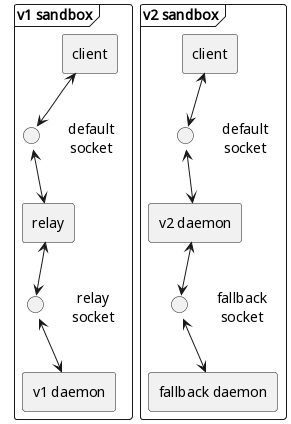
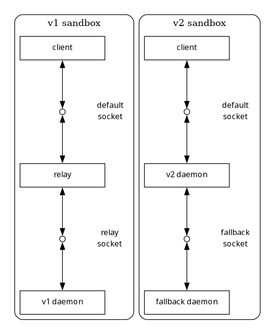

#+title: Guix Guile Daemon Development (GuGuDaDe)
# ------------------------------------------------------------------------------
* Glossary

*derivation* - low-level build actions and the environment in which they are performed.

*store* - place where successfully build derivations are stored (defaults to /gnu/store). Store has an associated database (defaults to /var/guix/db).

*daemon* (guix build daemon) - specialized process that does such operations as building a package or running the garbage collector, querying the availability of a build result, etc. This is the only process that should have access to the store and its associated database to insure immutability assumptions of Guix’s functional model.

*v1 daemon* - a classic cpp daemon ported from nix

*v2 daemon* - a new dev guile daemon, targeting guix 2.0 (simplifying memory management, streamlining the bootstrap chain, and making the entire build process auditable in a single language)

*client* - the daemon listens for connections and spawns one sub-process for each session started by a client (one of the ‘guix’ sub-commands).

*sandbox* - namespace mount and user isolated environment for testing and logging guix client/daemon interactions

*v1 sandbox* - captures stdout, stderr, and other logs (RPC via relay) for v1-daemon

*v2 sandbox* - captures stdout, stderr, and other logs (RPC via relay) for v2-daemon

*relay* - a simple process that relays RPC between two sockets (default guix daemon socket, and relay socket) and logs the calls and payloads

*sockets*:
- default :: /var/guix/daemon-socket/socket
- relay :: relay socket in the v1-sandbox that v1-daemon is listening
- fallback :: fallback socket in the v2-sandbox that fallback-daemon (v1-daemon) is listening

* Developing Guix on Guix System
** Specification and Principles
- Reproducible development environment (RDE)
  - Host (Guix) System should not interfere/influence the development experiments and tests (reproducibility)
- Do not to break or mess with the host Guix System (containerization)
- Implement 'working' daemon from the start (RPC relay with fallback)
- Keep the dev daemon always working (modular test driven development - TDD)
  
** Problems
- ~/gnu/store~ path is 'hardcoded' into substitutes binairies (we need overlayfs)
- guix tests use env-var redirection, not mount-namespace virtualization
- we need to see hosts ~/gnu/store~ (why do we need overlayfs?)
  - maybe prepopulate store with some minimal set (guix, dev tools, etc.)
  - =guix gc --requisites= (copy or link?)
- =guix shell --container= does not provide overlayfs mounts
- overlayfs have different inode/link behavior and affect dedup/hardlink semantics
- native guix tests have env isolation with =test-env= (no namespaces)
- poor native RPC logging
  - GUIX_PROFILING=rpc records RPC counts (guix/store.scm:631,840-861), but not payloads
  - Guix System service-level logs to /var/log/guix-daemon.log
  - =guix-daemon --debug= logs accepted connections and final op count

  
** Approach
- reproducibility :: =guix time-machine= and =guix shell --pure=
- isolation ::
  - user and mount (nested) namespaces
  - overlayfs mount for ~/gnu/store~
  - disable dedup/hardlink by default (creates another problem for tests?)
- logging :: relay guix daemon
- tdd :: Implement all tests with =ares-suitbl=

#+BEGIN_SRC plantuml :results replace file :file object-diagram.png :exports results
  @startuml
  !pragma layout smetana
  skinparam linetype ortho
  skinparam shadowing false
  skinparam defaultTextAlignment center

  frame "v1 sandbox" as V1 {
    rectangle "client" as V1_Client
    circle " " as V1_DefaultSocket
    label "default\nsocket" as V1_DefaultLabel
    rectangle "relay" as V1_Relay
    circle " " as V1_RelaySocket
    label "relay\nsocket" as V1_RelayLabel
    rectangle "v1 daemon" as V1_Daemon

    V1_Client <-down-> V1_DefaultSocket
    V1_DefaultSocket <-down-> V1_Relay
    V1_Relay <-down-> V1_RelaySocket
    V1_RelaySocket <-down-> V1_Daemon

    V1_DefaultSocket -[hidden]right-> V1_DefaultLabel
    V1_RelaySocket -[hidden]right-> V1_RelayLabel
  }

  frame "v2 sandbox" as V2 {
    rectangle "client" as V2_Client
    circle " " as V2_DefaultSocket
    label "default\nsocket" as V2_DefaultLabel
    rectangle "v2 daemon" as V2_Daemon
    circle " " as V2_FallbackSocket
    label "fallback\nsocket" as V2_FallbackLabel
    rectangle "fallback daemon" as V2_FallbackDaemon

    V2_Client <-down-> V2_DefaultSocket
    V2_DefaultSocket <-down-> V2_Daemon
    V2_Daemon <-down-> V2_FallbackSocket
    V2_FallbackSocket <-down-> V2_FallbackDaemon

    V2_DefaultSocket -[hidden]right-> V2_DefaultLabel
    V2_FallbackSocket -[hidden]right-> V2_FallbackLabel
  }

  V1 -right[hidden]- V2
  @enduml
#+END_SRC

#+RESULTS:

#+BEGIN_SRC plantuml :results replace file :file dot-diagram.png :exports results
  @startdot
  digraph G {
    graph [rankdir=TB, splines=ortho, nodesep=0.55, ranksep=0.8, newrank=true, pad=0.2];
    node  [fontname="Sans", fontsize=12, shape=box, width=1.8, height=0.5, fixedsize=true];
    edge  [dir=both, arrowhead=normal, arrowtail=normal];

    subgraph cluster_v1 {
      label="v1 sandbox"; style=rounded;

      node [group="v1_main"];
      v1_client [label="client"];
      v1_relay [label="relay"];
      v1_daemon [label="v1 daemon"];

      node [shape=circle, label="", width=0.12, height=0.12, fixedsize=true, group="v1_main"];
      v1_default;
      v1_relay_sock;

      node [shape=plaintext, fixedsize=false, group="v1_lbl"];
      v1_default_lbl [label="default\nsocket"];
      v1_relay_sock_lbl [label="relay\nsocket"];

      v1_client -> v1_default -> v1_relay -> v1_relay_sock -> v1_daemon;
      v1_default -> v1_default_lbl [style=invis, dir=none, constraint=false];
      v1_relay_sock -> v1_relay_sock_lbl [style=invis, dir=none, constraint=false];

      {rank=same; v1_default; v1_default_lbl}
      {rank=same; v1_relay_sock; v1_relay_sock_lbl}
    }

    subgraph cluster_v2 {
      label="v2 sandbox"; style=rounded;

      node [group="v2_main"];
      v2_client [label="client"];
      v2_daemon [label="v2 daemon"];
      v2_fallback_daemon [label="fallback daemon"];

      node [shape=circle, label="", width=0.12, height=0.12, fixedsize=true, group="v2_main"];
      v2_default;
      v2_fallback_sock;

      node [shape=plaintext, fixedsize=false, group="v2_lbl"];
      v2_default_lbl [label="default\nsocket"];
      v2_fallback_lbl [label="fallback\nsocket"];

      v2_client -> v2_default -> v2_daemon -> v2_fallback_sock -> v2_fallback_daemon;
      v2_default -> v2_default_lbl [style=invis, dir=none, constraint=false];
      v2_fallback_sock -> v2_fallback_lbl [style=invis, dir=none, constraint=false];

      {rank=same; v2_default; v2_default_lbl}
      {rank=same; v2_fallback_sock; v2_fallback_lbl}
    }

    {rank=same; v1_client; v2_client}
  }
  @enddot
#+END_SRC

#+RESULTS:

* Containers (unshare vs guix shell -C)

#+BEGIN_SRC shell
  guix shell -C coreutils guix --share=/tmp/tmp-store=/gnu/store --writable-root --share=/tmp/tmp-sock=/var/guix/daemon-socket/ --network --share=/etc/guix/acl
#+END_SRC

pros
- unprivileged user
- process isolation
- interprocess comms
- clean fs (pivot_root)

How to keep process demonized?
#+BEGIN_SRC shell

  guix shell -C coreutils -- /bin/sh -c 'sleep 99999' &

  wrap=$!

  child=$(cat /proc/$wrap/task/$wrap/children | awk '{print $1}')

  nsenter --target "$child" --user --mount --preserve-credentials -- /bin/sh

  guix shell -C coreutils guix --share=/tmp/tmp-store=/gnu/store --writable-root --share=/tmp/tmp-sock=/var/guix/daemon-socket/ --network --share=/etc/guix/acl -- guix-daemon &

  ls /proc/15828/task

  # guix shell -C coreutils -- /bin/sh -c 'sleep 99999' &
  # [1] 15254

  # stas@slim ~/org/job/guix-guile-daemon$ pstree -p 15254
  # guix(15254)─┬─guix(15269)───sleep(15270)
  #             ├─{guix}(15255)
  #             ├─{guix}(15256)
  #             ├─{guix}(15257)
  #             ├─{guix}(15258)
  #             ├─{guix}(15259)
  #             ├─{guix}(15260)
  #             ├─{guix}(15261)
  #             ├─{guix}(15262)
  #             ├─{guix}(15263)
  #             ├─{guix}(15264)
  #             ├─{guix}(15265)
  #             └─{guix}(15267)

  # explain why there so many processes (i have 12 cores)
#+END_SRC

* Test Driven Development
Specification:
- import native guix tests (in the following order)
  - tests/store.scm :: Core protocol + store RPC behavior
    - connection handshake and URI handling
    - `set-build-options`
    - add/query/delete path ops
    - roots/referrers/requisites
    - build requests, build logs/traces
    - substitute query/fetch/fallback/hash mismatch
    - import/export/verify-store
    - build-core settings and multiplexed output
  - tests/derivations.scm :: Build engine behavior via client API
    - Covers derivation build semantics, timeouts, keep-going, built-in builders, build plans, substitute-aware planning, etc.
  - tests/guix-daemon.sh :: Covers daemon-specific CLI/runtime behavior
    - `--listen` (multiple endpoints, TCP/UNIX)
    - `--no-substitutes` precedence over client options
    - `--cache-failures`
    - `--cores`, `--timeout`, `--max-silent-time`
    - GC denied over TCP
    - log compression
  - GC/db/concurrency/processes
    - tests/store-roots.scm :: GC roots
    - tests/store-database.scm :: store DB registration/invariants
    - tests/store-deadlock.scm :: multi-client deadlock regression
    - tests/processes.scm :: client session/lock visibility in daemon
  - Related transport/substitute integrity
    - tests/nar.scm :: restore/import signatures/corruption
    - tests/substitute.scm :: guix substitute narinfo/signature/url behavior
- save subsitutes localy for reproducible tests
  - official guix servers might not keep everything for long
  - own substitute server ()

#+BEGIN_SRC markdown
  # Guix daemon rewrite (Guile): test coverage checklist

  Generated: 2026-05-20  
  Source analyzed: `~/repos/guix`

  This is a file-by-file map of daemon/client interaction tests you can port.

  ---

  ## 0) Harness parity (do this first)

  - [ ] Provide a `test-env` equivalent (isolated store/state/db/log/cache, temporary daemon socket).
  - [ ] Start daemon automatically for tests (unless a test starts its own daemon explicitly).
  - [ ] Export equivalents of:
    - `NIX_STORE_DIR`
    - `GUIX_STATE_DIRECTORY`
    - `GUIX_DATABASE_DIRECTORY`
    - `GUIX_BINARY_SUBSTITUTE_URL`
    - `XDG_CACHE_HOME`
  - [ ] Force deterministic test env defaults (`--no-grafts`, neutral locale, clean package path).
  - [ ] Add fake substitute directory + signing keys fixture support.

  Reference: `~/repos/guix/test-env`, `~/repos/guix/guix/tests.scm`

  ---

  ## 1) RPC/API coverage matrix (what to implement + where tested)

  ## P0 (core daemon protocol)

  - [ ] `open-connection` / handshake / URI handling  
    Tested in: `tests/store.scm`, `tests/guix-daemon.sh`
  - [ ] `set-build-options` (substitutes, fallback, timeout, max-silent-time, build-cores, trace options)  
    Tested in: `tests/store.scm`, `tests/derivations.scm`, `tests/guix-daemon.sh`
  - [ ] Store insertion: `add-text-to-store`, `add-data-to-store`, `add-to-store`, `add-file-tree-to-store`  
    Tested in: `tests/store.scm`, `tests/derivations.scm`
  - [ ] Query ops: `valid-path?`, `query-path-info`, `references`, `referrers`, `requisites`, `valid-derivers`  
    Tested in: `tests/store.scm`, `tests/store-database.scm`
  - [ ] Build ops: `build-derivations`, `build-things`  
    Tested in: `tests/store.scm`, `tests/derivations.scm`, `tests/guix-daemon.sh`, `tests/store-deadlock.scm`
  - [ ] Substitute ops: `has-substitutes?`, `substitutable-paths`, `substitutable-path-info`, `ensure-path`  
    Tested in: `tests/store.scm`, `tests/derivations.scm`
  - [ ] Import/export: `export-paths`, `import-paths` (+ error handling)  
    Tested in: `tests/store.scm`
  - [ ] Integrity: `verify-store` (+ `#:check-contents?`)  
    Tested in: `tests/store.scm`

  ## P1 (daemon behavior + robustness)

  - [ ] Failed build cache: `query-failed-paths`, `clear-failed-paths`  
    Tested in: `tests/guix-daemon.sh`
  - [ ] GC roots API: `add-indirect-root`, `add-permanent-root`, `find-roots`, `gc-roots`  
    Tested in: `tests/store.scm`, `tests/store-roots.scm`
  - [ ] Concurrency/no deadlock under competing clients  
    Tested in: `tests/store-deadlock.scm`
  - [ ] Multiplexed build output + log retrieval (`log-file`)  
    Tested in: `tests/store.scm`, `tests/guix-daemon.sh`
  - [ ] DB registration/invariants (`register-items`, `register-valid-path`)  
    Tested in: `tests/store-database.scm`

  ## P2 (substituter/process introspection extras)

  - [ ] `guix substitute` protocol compatibility (narinfo signatures, URL fallback, invalid/corrupt nar handling)  
    Tested in: `tests/substitute.scm`
  - [ ] Archive restore integrity (`restore-file-set`: signed/missing-signature/corrupt)  
    Tested in: `tests/nar.scm`
  - [ ] Daemon process/session introspection (`daemon-sessions`, lock tracking)  
    Tested in: `tests/processes.scm`

  ---

  ## 2) File-by-file checklist

  ### `tests/store.scm` (P0, biggest one)

  Use this as your primary protocol parity suite.

  - [ ] Connection/handshake/URI (`file://`, handshake error behavior).
  - [ ] Build options roundtrip and behavior changes (`substitute-urls`, no-substitutes).
  - [ ] Store path add/query/remove lifecycle.
  - [ ] Roots and liveness (`dead-paths`, `live-paths`, temp/indirect/permanent roots).
  - [ ] Query graph correctness (`references`, `requisites`, `referrers`, `derivers`).
  - [ ] Build sandbox expectations (RO inputs, namespace isolation, network restrictions).
  - [ ] Build output/log behavior (`current-build-output-port`, `log-file`, multiplexed logs).
  - [ ] Substitution path: query -> fetch -> fallback -> hash mismatch errors.
  - [ ] Import/export stream behavior (topological order, incomplete stream errors, signature errors).
  - [ ] Verify/check mode behavior (detect corruption, non-determinism in check mode).
  - [ ] Build-core semantics (`NIX_BUILD_CORES` propagation).

  ### `tests/derivations.scm` (P0)

  Covers build semantics from derivation APIs.

  - [ ] Basic derivation build success/failure and keep-going behavior.
  - [ ] Built-in builders (`download`, `git-download`) and failure modes.
  - [ ] Fixed-output derivation validation (hashes, network policy constraints).
  - [ ] Multiple outputs behavior.
  - [ ] Ref constraints (`#:allowed-references`, `#:disallowed-references`).
  - [ ] Timeout/max-silent-time enforcement via build options.
  - [ ] Build planning parity (`derivation-build-plan` incl. substitute-aware plan).

  ### `tests/guix-daemon.sh` (P0/P1, daemon CLI behavior)

  Critical for daemon process behavior, not just RPC surface.

  - [ ] `--no-substitutes` cannot be overridden by client options.
  - [ ] Multiple `--listen` endpoints all work (unix + TCP).
  - [ ] TCP usage creates `profiles/per-user/$USER` in state dir.
  - [ ] `--cache-failures` wires to failed-path query/clear API.
  - [ ] `--cores=N` is reflected in build env.
  - [ ] `--max-silent-time` and `--timeout` kill hanging builders.
  - [ ] GC over TCP is denied.
  - [ ] `--log-compression=gzip` produces compressed logs readable by client tooling.

  ### `tests/store-deadlock.scm` (P1)

  - [ ] No deadlock when multiple clients concurrently build overlapping derivations.
  - [ ] Completion under deadline (regression for lock scheduling/contention).

  ### `tests/store-roots.scm` (P1)

  - [ ] `gc-roots` sees regular root symlink.
  - [ ] `gc-roots` sees indirect root after `add-indirect-root`.

  ### `tests/store-database.scm` (P1)

  - [ ] `register-items` makes paths valid with correct refs metadata.
  - [ ] Directory registration canonical metadata checks.
  - [ ] DB schema/invariants: reject unregistered refs; reject invalid nar size.

  ### `tests/nar.scm` (P2)

  - [ ] `restore-file-set` success with valid signatures.
  - [ ] Proper failure on missing signature.
  - [ ] Proper failure on corrupt archive hash.
  - [ ] Canonicalization/dedup behavior after restore.

  ### `tests/substitute.scm` (P2)

  Primarily substituter-side, but needed for daemon+substituter integration confidence.

  - [ ] Narinfo signature validation and version checks.
  - [ ] Authorized vs unauthorized key handling.
  - [ ] Multi-URL behavior (unroutable first, 404 nar, fallback URLs).
  - [ ] Invalid hash/refs narinfo rejection.

  ### `tests/processes.scm` (P2)

  - [ ] Client session appears in daemon session list.
  - [ ] Lock ownership is visible while build is running.
  - [ ] Correct skip behavior on binfmt/qemu-user constraints.

  ---

  ## 3) Recommended porting order

  1. `tests/store.scm` (connection, build, substitute, import/export, verify)  
  2. `tests/derivations.scm` (derivation semantics and planner)  
  3. `tests/guix-daemon.sh` (daemon runtime flags/behavior)  
  4. `tests/store-deadlock.scm` + `tests/store-roots.scm` + `tests/store-database.scm`  
  5. `tests/substitute.scm` + `tests/nar.scm` + `tests/processes.scm`

  ---

  ## 4) Quick “done” definition for MVP parity

  Consider MVP parity reached when all items below pass:

  - [ ] Connection + handshake + per-connection build options
  - [ ] Build execution (`build-derivations` / `build-things`) with timeout and keep-going behavior
  - [ ] Substitute query/fetch/fallback/hash-mismatch handling
  - [ ] Root/ref graph correctness and GC root tracking
  - [ ] Import/export + signature/corruption error handling
  - [ ] Daemon CLI behavior from `tests/guix-daemon.sh`
  - [ ] No deadlock with concurrent clients

#+END_SRC

* Guix Protocol (RPC IDL)

*Problems*:
- Protocol is mostly 'code defined' (and a bit fragmented)
  - RPC IDL and types: =guix/remote-procedures.scm=
  - wire serialization: =guix/serialization.scm=
  - client handshake/stubs: =guix/store.scm=
  - server constants/opcodes: =nix/libstore/worker-protocol.hh=
  - server dispatcher: =nix/nix-daemon/nix-daemon.cc=
  - daemon/store code: =nix/libstore/local-store.cc=, =nix/libstore/build.cc=
  - helper process =guix substitute=: =guix/scripts/substitute.scm=
- Incomplete documentation
  - Info's section *The Store*: 'This section is currently incomplete' (doc/guix.texi:12129)
- Security note about protocol
  - 'unauthenticated and unencrypted' (doc/guix.texi:1915)

#+BEGIN_SRC markdown
  # Guix client ↔ daemon worker protocol (practical spec)

  Generated from source in `~/repos/guix`.

  ## Scope

  This is the main protocol between `(guix store)` clients and `guix-daemon` (`nix-daemon`).

  Authoritative sources:

  - RPC IDL and types: `guix/remote-procedures.scm`
  - wire serialization: `guix/serialization.scm`
  - client handshake/stubs: `guix/store.scm`
  - server constants/opcodes: `nix/libstore/worker-protocol.hh`
  - server dispatcher: `nix/nix-daemon/nix-daemon.cc`

  The manual has API docs in *The Store* but explicitly says section is incomplete.

  ---

  ## Transport

  Single bidirectional byte stream (usually Unix socket, optionally TCP/SSH wrappers).

  All control, RPC args/results, and build-log side channel markers go over this same stream.

  ---

  ## Handshake

  Constants (`worker-protocol.hh` / `remote-procedures.scm`):

  - `WORKER_MAGIC_1 = 0x6e697863` (`"nixc"`)
  - `WORKER_MAGIC_2 = 0x6478696f` (`"dxio"`)
  - `PROTOCOL_VERSION = 0x164`

  Sequence:

  1. client -> server: `WORKER_MAGIC_1`
  2. server -> client: `WORKER_MAGIC_2`
  3. server -> client: server protocol version
  4. client validates compatibility
  5. client -> server: client protocol version
  6. client -> server: cpu-affinity flag (and value if set; protocol minor >= 14)
  7. client -> server: reserve-space flag (protocol minor >= 11)

  Client-side code: `guix/store.scm::open-connection`  
  Server-side code: `nix-daemon.cc::processConnection`

  ---

  ## Wire encoding primitives

  Defined in `guix/serialization.scm`.

  - `integer`: 8 bytes total, little-endian u32 in low bytes, remaining padding
  - `long-long`: 8 bytes little-endian u64
  - `boolean`: encoded as integer `0` or `1`
  - `utf8-string` / `bytevector`:
    - length as `integer`
    - payload bytes
    - zero padding to 8-byte boundary
  - lists/pairs: count then elements
  - store-path is serialized as string (server validates where needed)

  ---

  ## RPC framing model

  Per operation:

  1. client writes op ID (`integer`)
  2. client writes typed args
  3. client flushes
  4. server executes and may emit stderr/build events (cookie-framed)
  5. server ends operation with `STDERR_LAST` or `STDERR_ERROR`
  6. if success: server writes typed return values

  Client loops on `process-stderr` until operation end marker, then reads return payload.

  ---

  ## stderr/build side-channel cookies

  From `worker-protocol.hh` and handled in `guix/store.scm::process-stderr`.

  - `STDERR_NEXT  = 0x6f6c6d67`  : daemon log line (string)
  - `STDERR_READ  = 0x64617461`  : daemon requests stream bytes from client
  - `STDERR_WRITE = 0x64617416`  : daemon sends stream bytes to client
  - `STDERR_LAST  = 0x616c7473`  : operation completed successfully
  - `STDERR_ERROR = 0x63787470`  : operation failed; followed by message (+ optional status)

  `STDERR_READ/WRITE` are used by stream RPCs (e.g., import/export paths via tunnel source/sink in server).

  ---

  ## RPC operation IDs (current worker enum)

  From `nix/libstore/worker-protocol.hh`:

  - 1  `wopIsValidPath`
  - 3  `wopHasSubstitutes`
  - 4  `wopQueryPathHash`
  - 5  `wopQueryReferences`
  - 6  `wopQueryReferrers`
  - 7  `wopAddToStore`
  - 8  `wopAddTextToStore`
  - 9  `wopBuildPaths`
  - 10 `wopEnsurePath`
  - 11 `wopAddTempRoot`
  - 12 `wopAddIndirectRoot`
  - 13 `wopSyncWithGC`
  - 14 `wopFindRoots`
  - 16 `wopExportPath`
  - 18 `wopQueryDeriver`
  - 19 `wopSetOptions`
  - 20 `wopCollectGarbage`
  - 21 `wopQuerySubstitutablePathInfo`
  - 22 `wopQueryDerivationOutputs`
  - 23 `wopQueryAllValidPaths`
  - 24 `wopQueryFailedPaths`
  - 25 `wopClearFailedPaths`
  - 26 `wopQueryPathInfo`
  - 27 `wopImportPaths`
  - 28 `wopQueryDerivationOutputNames`
  - 29 `wopQueryPathFromHashPart`
  - 30 `wopQuerySubstitutablePathInfos`
  - 31 `wopQueryValidPaths`
  - 32 `wopQuerySubstitutablePaths`
  - 33 `wopQueryValidDerivers`
  - 34 `wopOptimiseStore`
  - 35 `wopVerifyStore`
  - 80 `wopBuiltinBuilders`
  - 81 `wopSubstituteURLs`

  Typed signatures for the Guix-facing RPC set are in `guix/remote-procedures.scm`.

  ---

  ## Set-options (`wopSetOptions`) note

  `wopSetOptions` has protocol-minor dependent parsing on server side (`nix-daemon.cc`).

  Modern clients mostly pass extended settings as `name=value` string pairs (e.g. timeout, build-cores, substitute-urls, locale, terminal columns, trace toggles).

  For untrusted clients, server rewrites many keys as `untrusted-*`.

  ---

  ## Store-path validation behavior

  Server validates many path inputs with `assertStorePath` (must be direct store paths under configured store root).

  Configured store root is `settings.nixStore`, derived from env (`NIX_STORE_DIR` etc.) in `nix/libstore/globals.cc`.

  So the protocol is store-prefix sensitive by configuration.

  ---

  ## Security note

  Manual explicitly warns protocol is unauthenticated/unencrypted for plain TCP mode.
  Use local Unix sockets or trusted networks / SSH transport.

  ---

  ## Implementation advice for a compatible daemon

  Minimum needed for protocol parity testing:

  1. exact handshake values/order
  2. exact serialization semantics (+ 8-byte padding)
  3. stderr cookie state machine
  4. `wopSetOptions` behavior sufficient for tested keys
  5. core ops used by tests (`build`, substitutes, path queries, import/export, GC-related)

#+END_SRC

#+BEGIN_SRC markdown
  # Guix daemon ↔ `guix substitute` protocol (practical spec)

  Generated from source in `~/repos/guix`.

  ## Scope

  This is the protocol between:

  - daemon/store code (`nix/libstore/local-store.cc`, `nix/libstore/build.cc`), and
  - helper process `guix substitute` (`guix/scripts/substitute.scm`).

  This is **not** the main client↔daemon worker RPC protocol.

  ---

  ## Process model

  The daemon spawns `guix substitute` as an `Agent`.

  Two modes are used:

  1. `guix substitute --query`
     - used for substitute availability and metadata lookup.
  2. `guix substitute --substitute`
     - used to download and materialize a substitute.

  Daemon passes options through environment variable `_NIX_OPTIONS`.

  Relevant code:
  - `nix/libstore/local-store.cc` (`substituter`, `querySubstitutablePaths`, `querySubstitutablePathInfos`)
  - `nix/libstore/build.cc` (`SubstitutionGoal`)
  - `guix/scripts/substitute.scm` (`daemon-options`, `find-daemon-option`)

  ---

  ## File descriptors / channels

  `Agent` wiring (`nix/libutil/util.cc`):

  - daemon -> substituter commands: substituter `stdin`
  - substituter protocol replies: **fd 4** (dup of `builderOut.writeSide`)
  - substituter logs/diagnostics: normal stdout/stderr channel captured separately

  On substituter side (`guix/scripts/substitute.scm`):

  - `%reply-file-descriptor` defaults to `4`
  - if fd 4 unavailable, replies can go to stdout (used by tests)

  Test note: `tests/substitute.scm` sets `%reply-file-descriptor` to `#f`.

  ---

  ## `--query` subprotocol

  ### Requests (daemon -> substituter)

  Line-oriented commands on stdin:

  - `have <store-path> <store-path> ...`
  - `info <store-path> <store-path> ...`

  ### Replies (`reply-port` -> daemon)

  #### `have`

  - one line per substitutable path
  - final empty line terminator

  #### `info`

  For each substitutable path, write lines in this order:

  1. path
  2. deriver path (or empty string)
  3. number of references
  4. one reference path per line
  5. download size
  6. nar size

  Then final empty line terminator.

  Formatting is implemented by `display-narinfo-data`.

  ### Validation semantics

  - `guix substitute` filters narinfos by signature/ACL unless unauthenticated substitutes are allowed.
  - It reconstructs full deriver/reference paths under current `%store-prefix`.
  - Daemon validates received paths with `assertStorePath`.

  ---

  ## `--substitute` subprotocol

  ### Request (daemon -> substituter)

  One line:

  `substitute <store-path> <destination>`

  ### Reply (substituter -> daemon)

  Exactly one status line per request:

  - `success <hash> <nar-size>`
  - `hash-mismatch <algo> <expected> <actual>`
  - `not-found`

  Daemon expects one status line; additional unexpected lines are treated as protocol noise/errors in logs.

  ### Behavior on success

  `guix substitute`:

  - picks a nar URL from narinfo,
  - downloads/decompresses,
  - restores NAR to destination,
  - optionally deduplicates when destination is inside store and deduplication is enabled,
  - computes actual hash and compares against expected hash.

  Daemon then registers resulting path in DB with references/deriver previously obtained from query info.

  ---

  ## `_NIX_OPTIONS` influence

  Substituter reads daemon options from `_NIX_OPTIONS` and uses values such as:

  - `substitute-urls` / `untrusted-substitute-urls`
  - `locale` / `untrusted-locale`
  - `terminal-columns` / `untrusted-terminal-columns`
  - `print-extended-build-trace`
  - `deduplicate`
  - `discover` (for local substitute discovery)

  `daemon-options` parses newline-separated `name=value` pairs.

  ---

  ## Minimal wire examples

  ### Query

  Request:

  `have /gnu/store/aaaaaaaaaaaaaaaaaaaaaaaaaaaaaaaa-foo`

  Reply:

  `/gnu/store/aaaaaaaaaaaaaaaaaaaaaaaaaaaaaaaa-foo`
  `<empty line>`

  ### Substitute

  Request:

  `substitute /gnu/store/aaaaaaaaaaaaaaaaaaaaaaaaaaaaaaaa-foo /gnu/store/aaaaaaaaaaaaaaaaaaaaaaaaaaaaaaaa-foo`

  Reply (success case):

  `success sha256:... 12345`

  ---

  ## Source of truth

  - `guix/scripts/substitute.scm` (section: `Daemon/substituter protocol`)
  - `nix/libstore/local-store.cc` (query mode integration)
  - `nix/libstore/build.cc` (`SubstitutionGoal`, substitute mode integration)
  - `nix/libutil/util.cc` (`Agent` fd wiring)

#+END_SRC

* Plan
- 
